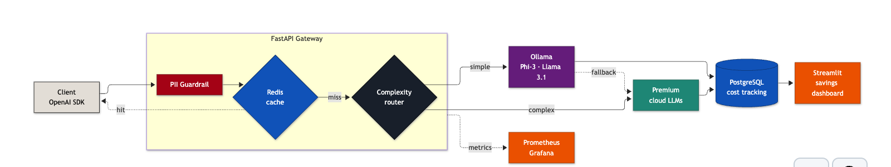

# Local SLM Router API

An AI "traffic controller" that sends easy questions to a free AI model running on your own computer, and only pays for a powerful cloud AI when a question really needs it.

## Project Description

> **Project status: in progress.** This project is still being built. This README describes the full plan: what the router is designed to do and how it will work when it's finished. Some parts are already working and tested. Others, such as the final quality tests and the demo material, are still in development.

AI chat tools like ChatGPT run on very large models that live in the cloud. Each question costs money. But many questions are simple, like "Hi, what can you do?" or "Summarise this paragraph". A much smaller and cheaper model could answer those just as well.

This project is a **router**. It sits between an app and the AI models. It reads each incoming question, gives it a **complexity score from 0 to 100**, and decides where to send it:

- **Score under 30:** the question goes to a **small language model (SLM)** running locally on our own machine. It costs nothing per question.
- **Score of 30 or more:** the question goes to a **premium cloud model**, which costs money but handles harder work better.

Think of it like a hospital triage desk. A nurse checks each patient. Minor cases see a general practitioner straight away. Serious cases go to the specialist. Nobody waits for the specialist for a plaster, and nobody with a serious problem gets sent home with one.

Every answer also **explains itself**. It says which model answered, why it was picked, what score the question got, what it cost, and how much it saved compared with always using the cloud. A dashboard shows these savings over time.

**How to read this diagram**

1. A **client application** (a chat app, a script, or our demo web page) sends a question to the router.
2. The **API gateway** checks the caller's access key and makes sure the request is well formed.
3. The **guardrails** reject requests that are far too long and scan for personal details such as email addresses, phone numbers and card numbers.
4. The router checks the **Redis cache** to see if it has answered this exact question recently. If so, it replies instantly for free.
5. The **prompt classifier** works out what kind of task it is (a greeting, a translation, code, maths and so on) and gives it a complexity score.
6. The **routing policy** applies a few safety rules, then compares the score with the threshold of 30 to choose local or cloud.
7. The question goes either to a **local model** running in Ollama or to the **premium cloud model**.
8. If the local model fails or is too slow, the router **falls back** to the cloud model automatically.
9. The **response aggregator** puts every answer into the same format and adds the routing explanation, cost and savings.
10. The answer goes back to the client. A record is saved in **PostgreSQL**, and live numbers go to **Prometheus and Grafana** for the dashboard.

## Why This Project Exists

**The problem.** Businesses that add AI to their products often send every request to the most powerful cloud model. That is the safe choice, but it is expensive. Most of those requests are simple, so a lot of the money is wasted. There is also a privacy concern: every question, including any personal data in it, leaves the company's computers.

**An example.** Imagine a small online shop with an AI help assistant. Most messages are "Hi", "Where is my order?" or "Can you rewrite this in French?". A few are hard, like "Compare these three products for my use case, step by step." Today, the shop pays cloud prices for all of them. And when a customer types their email address, it is sent to an outside company.

**How this project helps.**

- **Lower costs:** simple questions are answered by a free local model. Only demanding ones reach the paid cloud model.
- **Transparency:** every answer says *why* it was routed where it was, so decisions can be checked and improved.
- **Privacy:** in "privacy mode", any question containing personal data stays on the local machine, even if someone asks for the cloud.
- **Reliability:** if the local model goes down, the router quietly switches to the cloud instead of failing.
- **Easy to adopt:** the router accepts the same request format as OpenAI's tools. An existing app can switch to it by changing one web address.

## Thought Process & Approach

The steps below follow **the order a question travels through the system**. The last step covers how we tested and tuned it.

### Step 1: A front door that existing apps already understand

- **What it does:** Receives questions in exactly the same format OpenAI uses, so any app built for ChatGPT can talk to the router without code changes. The app just asks for the model `"auto"`.
- **Why we did it this way:** Being a "drop-in replacement" is the most convincing thing to show. Nobody has to learn a new system.
- **What we considered instead:** Designing our own custom format. It would have been simpler to build but harder for anyone to use.
- **Trade-off:** We gained instant compatibility. We gave up some freedom in how requests are shaped, and we do not yet support streaming responses.

### Step 2: Safety checks and privacy protection

- **What it does:** Rejects extremely long requests and scans every message for personal data (emails, phone numbers, card numbers, bank account numbers and some national ID numbers). Stored records only keep a short, masked preview, with personal data replaced by labels like `[EMAIL]`.
- **Why we did it this way:** Personal data should never end up in our database or in screenshots. With privacy mode switched on, questions containing it never leave the machine.
- **What we considered instead:** Not checking at all, or using a heavier AI-based detector.
- **Trade-off:** Pattern-based detection is fast, free and predictable. But it can miss personal data that does not follow a known pattern, such as a person's name or home address.

### Step 3: Remembering repeated questions

- **What it does:** If the exact same request arrives again within an hour, the router returns the saved answer instantly at no cost.
- **Why we did it this way:** It is simple, and it shows up clearly as extra savings on the dashboard.
- **What we considered instead:** A semantic cache that also matches questions with the *same meaning* but different wording.
- **Trade-off:** Exact matching never returns a wrong answer for a different question. But it misses near-duplicates like "What's the capital of France?" versus "Capital of France?". Answers to questions containing personal data are never cached.

### Step 4: Scoring how hard each question is

- **What it does:** Labels the question as one of ten task types and gives it base points. A greeting starts at 0, a simple question at 10, a summary at 15, code at 35 and maths or analysis at 40. Extra points are added for things that make a question harder: long input, phrases like "step by step", multiple questions at once, requests for a "detailed report", or a long conversation.
- **Why we did it this way:** We used **keyword rules**. They are free, instant, give the same result every time, and can be explained line by line. Every answer includes the full points breakdown.
- **What we considered instead:** Asking a small AI model to judge difficulty, or training a classifier on example questions. Both are possible future upgrades.
- **Trade-off:** We gained full explainability and zero cost. We gave up accuracy: keywords see *what kind* of task it is, not *how hard* it really is. Our testing confirmed this is the router's main weakness (see Limitations).

### Step 5: Choosing local or cloud, then picking the model

- **What it does:** First applies four hard rules, in order: privacy, a caller's request to force a tier, whether the model supports the needed feature, and whether the question fits in the model's context window. Then the score decides: under 30 stays local, 30 or more goes to the cloud. Inside the local tier, greetings and simple questions go to **Phi-3 Mini** (the smallest and fastest), summaries, translations and rewrites go to **Mistral 7B**, and everything else goes to **Llama 3.1 8B**.
- **Why we did it this way:** Hard rules come first so that safety always wins. For example, a privacy rule cannot be overridden by a caller forcing the cloud.
- **What we considered instead:** Separate cloud models per task type. We kept one cloud model until testing shows a reason to split.
- **Trade-off:** One threshold is easy to understand and tune. But a single number cannot capture every nuance of difficulty.

### Step 6: Calling the model, with a safety net

- **What it does:** Sends the question to the chosen model with a time limit. If the local model errors, times out or returns an empty answer, the router retries once on the cloud model and records that a fallback happened. If the cloud model fails, it retries once after a short pause.
- **Why we did it this way:** A slow or crashed local model should not mean a failed answer for the user.
- **What we considered instead:** Failing straight away and letting the app deal with it.
- **Trade-off:** Users get an answer more often, but a fallback costs cloud money. Privacy-protected questions are **never** sent to the cloud as a fallback; they fail with a clear error instead.
- **Technical note:** All models (local and cloud) are reached through one shared OpenAI-compatible connector, because Ollama, OpenAI, Google Gemini and Anthropic all support that format. Adding a new model is a configuration change, not a code change.

### Step 7: One consistent answer, with costs and savings

- **What it does:** Puts every answer into the same format and attaches a "router" section: tier, model, reason, score, points breakdown, response time, cost, the cost if the cloud had been used, and the savings. The record is saved to the database in the background so the user does not wait.
- **Why we did it this way:** Showing the reasoning on every answer builds trust and makes mistakes easy to spot.
- **What we considered instead:** Comparing savings against the most expensive "flagship" cloud model. We rejected this because it would make the savings look bigger than they really are.
- **Trade-off:** The savings figure is honest but still an **estimate**, because a cloud model might have written a longer or shorter answer. If cloud prices are not configured, costs are stored as "unknown" rather than guessed.

### Step 8: Dashboards and a demo playground

- **What it does:** A Grafana dashboard shows six things: cost savings, the share of local versus cloud answers, response times, token usage, user thumbs-up ratings, and router accuracy from testing. A Streamlit playground lets anyone chat with the router and see a "routing card" for every answer.
- **Why we did it this way:** The dashboard is set up from files stored in the project, so it appears automatically. Streamlit gives a usable web page from a single Python file.
- **What we considered instead:** Building a custom dashboard and website from scratch with React.
- **Trade-off:** Much less effort for a professional-looking result, but less control over the design.

### Step 9: Testing the router and choosing the threshold

- **What it does:** We wrote **159 test questions** by hand, each labelled "local" or "premium" based on our judgement of what a small model could handle. We ran them all through the router for free (without calling any model) and measured how often it agreed with the labels. We then tried every threshold from 20 to 45.
- **Why we did it this way:** We treat two mistakes differently. Sending a hard question to a small model (**under-routing**) can give a worse answer. Sending an easy question to the cloud (**over-routing**) only wastes money. So under-routing matters more.
- **What we found:** At a threshold of 30, the router agreed with our labels **71.7%** of the time, kept **65.4%** of questions local, and saved an estimated **17.2%** on input costs compared with using the cloud for everything. However, it kept **39.1%** of the "hard" questions on the local model.
- **The decision:** We kept the threshold at 30. Lowering it to 20 only caught 5 more hard questions while sending 13 more easy ones to the cloud. Most of the misrouted hard questions scored so low that no threshold could catch them. The real fix is a smarter classifier, not a different number. Full details are in [docs/results.md](./docs/results.md).
- **Trade-off:** We chose stability and honesty over a tidier-looking number. We wrote down our reasoning rather than quietly tuning the results.

## Tech Stack

| Tool / Technology | Why we used it |
| --- | --- |
| **Python 3.12** | Widely used for AI work, with ready-made tools for counting tokens |
| **FastAPI** | Fast, validates incoming data automatically, and generates an API documentation page for free |
| **Pydantic** | Catches malformed requests before they cause problems |
| **Ollama** | One command to set up local models, runs without a GPU, and supports the OpenAI format |
| **Phi-3 Mini, Mistral 7B, Llama 3.1 8B** | Free local models, each suited to different simple tasks |
| **Premium cloud model** (OpenAI, Gemini or Anthropic) | Handles the hard questions; chosen in settings, not fixed in code |
| **tiktoken** | Estimates question length in tokens for routing |
| **PostgreSQL** | Stores one record per question; the dashboard reads from it directly |
| **Redis** | Holds recent answers for instant, free repeats |
| **Prometheus** | Tracks live response times and request counts |
| **Grafana** | Shows savings, routing mix and performance at a glance |
| **Streamlit** | A demo chat page with routing explanations, built in one file |
| **Docker Compose** | Starts the whole system with one command on one machine |
| **YAML config files** | Every threshold, keyword, model and price can be changed without touching code |
| **pytest, Ruff, uv** | Keep the code tested, tidy and easy to install |

## Limitations

- **The router misses many hard questions.** At the chosen threshold, 39.1% of questions labelled "needs premium" were kept on a local model. *In practice:* some tricky questions, such as maths word problems or demanding creative writing without obvious keywords, may get a weaker answer.
- **Some easy questions go to the cloud unnecessarily.** Any question that looks like code or maths starts with a high score, even something trivial like "23 × 47". *In practice:* some money is spent where it didn't need to be.
- **Keyword rules judge the type of task, not its difficulty.** A legal paraphrase and a casual rewrite look the same to the router. *In practice:* scoring is predictable and explainable, but not very smart.
- **Answer quality and speed have not been measured yet.** These tests need real local models and a paid cloud key, and have not been run. *In practice:* we cannot yet claim that local answers are "as good" as cloud ones.
- **Savings figures are estimates and only partial.** The test results only cover input text, not the length of answers, and cloud prices were not configured during testing. *In practice:* real savings will differ from the 17.2% figure.
- **The test set is small and written by one person.** It has 159 English questions, labelled by our own judgement, and the threshold was chosen on the same questions it was tested on. *In practice:* results may not match real-world traffic.
- **Personal data detection is pattern-based.** It finds emails, phone numbers, card numbers and some ID numbers, but not names or addresses. *In practice:* privacy mode protects common data types, not all of them.
- **No streaming responses.** *In practice:* users wait for the full answer before seeing anything, which can feel slow on long replies.
- **Built for one machine.** There is a single shared access key, no per-user accounts or billing, and no automatic scaling. *In practice:* it is a demonstration, not a ready-to-deploy product.
- **Local models can be slow without a GPU.** *In practice:* on an ordinary laptop, local answers may take noticeably longer than cloud ones.

## Future Improvements

### Short term

- **Run the answer-quality and speed tests** with real models and a cloud key. *Benefit:* real evidence of whether local answers hold up, and real response-time figures.
- **Improve the keyword rules** for maths word problems, logic puzzles and more creative forms (sonnets, speeches, scenes), and lower the starting score for one-line code and simple sums. *Benefit:* fewer hard questions kept local and fewer easy ones sent to the cloud. These changes need a separate set of test questions to be measured fairly.
- **Create a separate held-out test set.** *Benefit:* a fair check of any changes, instead of tuning and testing on the same questions.
- **Add screenshots, a demo video and automated testing on every code change.** *Benefit:* easier to understand the project at a glance and more confidence that it works.

### Long term

- **A learned classifier** trained on example questions instead of keyword lists, compared directly with the current rules. *Benefit:* better routing accuracy.
- **Cascade routing:** answer locally first, check the answer's quality, and only escalate to the cloud if it falls short. *Benefit:* catches hard questions that the score misses.
- **Streaming responses.** *Benefit:* a faster-feeling experience.
- **A semantic cache** that recognises questions with the same meaning. *Benefit:* more free, instant answers.
- **A daily spending cap** that forces local routing once a budget is reached. *Benefit:* predictable cloud bills.
- **A dedicated local coding model** and a native Anthropic integration. *Benefit:* more coding questions handled for free, and fuller support for Claude models.
- **Kubernetes support.** *Benefit:* a path from a single-machine demo towards larger-scale use.
